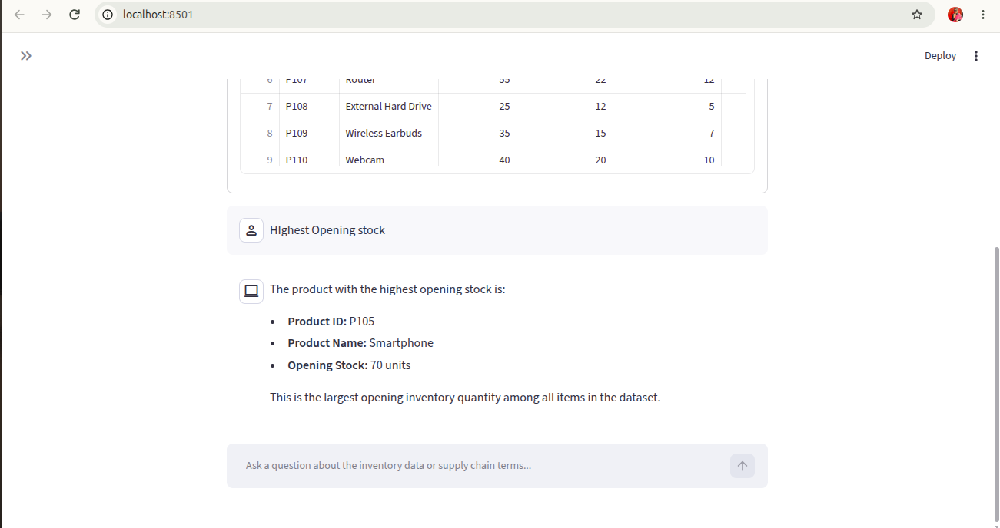
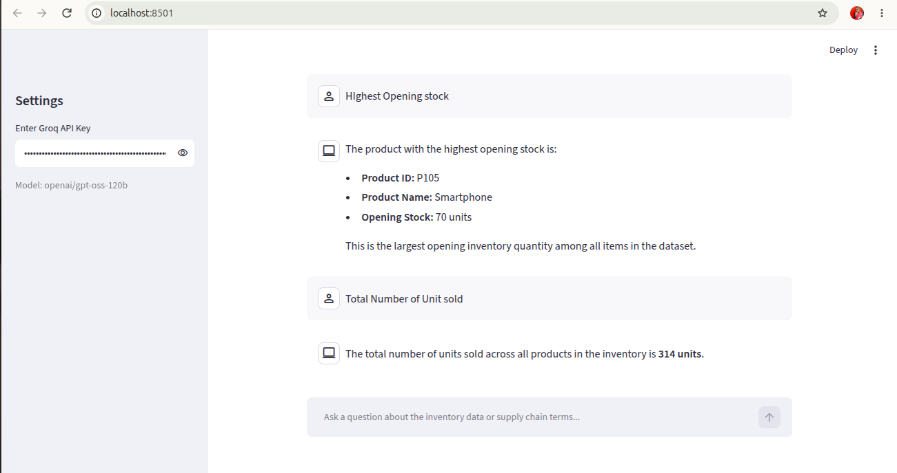

# Inventory Analysis Agent

A chat application that answers questions about an Excel inventory dataset. The agent writes and runs Pandas code to query the data, searches the web for definitions and business terms, and explains the result in plain English.

## Screenshots





## What it does

- Loads `Inventory-Records-Sample-Data.xlsx` and cleans it (skips the top banner rows, drops empty rows and columns, tidies the column names).
- Answers data questions by writing and executing Python code on the DataFrame.
- Looks up terms and formulas (for example "what is stock turnover") with a DuckDuckGo search tool.
- Keeps the conversation history, so follow-up questions work.

## Tech stack

- Streamlit for the chat interface
- LangChain tool-calling agent
- Groq LLM (`openai/gpt-oss-120b`)
- `PythonAstREPLTool` for running Pandas code
- `DuckDuckGoSearchRun` for web search

## Setup

1. Create and activate a virtual environment, then install the dependencies:

   ```
   python -m venv venv
   source venv/bin/activate
   pip install -r requirements.txt
   ```

2. Get a free API key from https://console.groq.com/keys.

3. Run the app:

   ```
   streamlit run app.py
   ```

4. Paste the Groq API key into the sidebar and start asking questions.

## Example questions

- Which product has the highest opening stock?
- What is the total number of units sold?
- Give me the list of product names.
- What does "opening stock" mean?

## How I built it

1. **Data loading.** The real column headers start on row 6, so the sheet is read with `skiprows=5`. Empty rows and columns are dropped, and line breaks in the headers are replaced with single spaces.
2. **Agent tools.** One tool runs Pandas code on the DataFrame, and the other searches the web. The system prompt tells the agent to always use code for numbers and search for definitions.
3. **Choosing an LLM.** I started with Google Gemini, but the free tier allows only about 20 requests per day per model and returned overload errors, and each question needs several model calls. I switched to Groq, which has a much larger free tier and responds quickly.
4. **Fixing tool calls.** One Groq model rejected tool calls because the Python tool's argument name did not match. Wrapping the Python tool with a clearly named `code` argument fixed it.
5. **Interface.** A simple Streamlit chat page with a dataset preview, a sidebar for the API key, saved chat history and a spinner while the agent works. The agent shows an error message in the chat instead of hanging if a request fails.

## Project files

- `app.py` - the full application
- `Inventory-Records-Sample-Data.xlsx` - the dataset
- `requirements.txt` - Python dependencies
- `screenshots/` - images used in this README

## Notes

- `langchain-experimental` prints a deprecation warning at startup. It is harmless.
- The agent runs generated Python code on the data, so run it only on files you trust.
